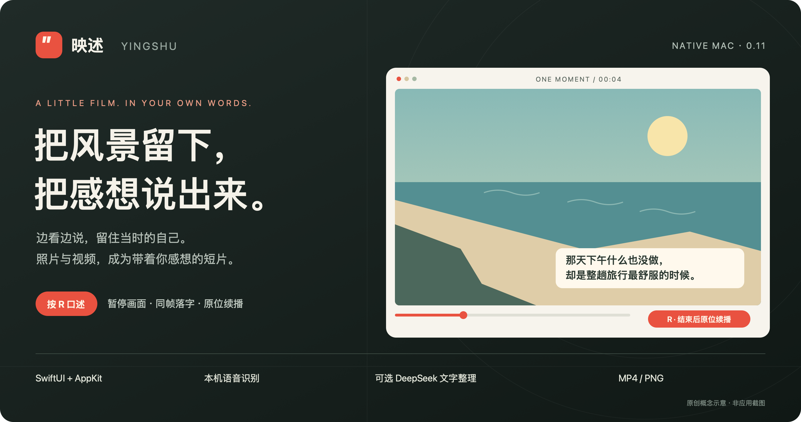
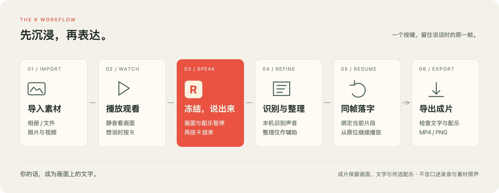
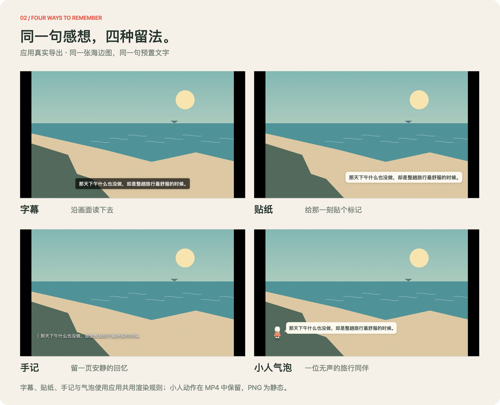
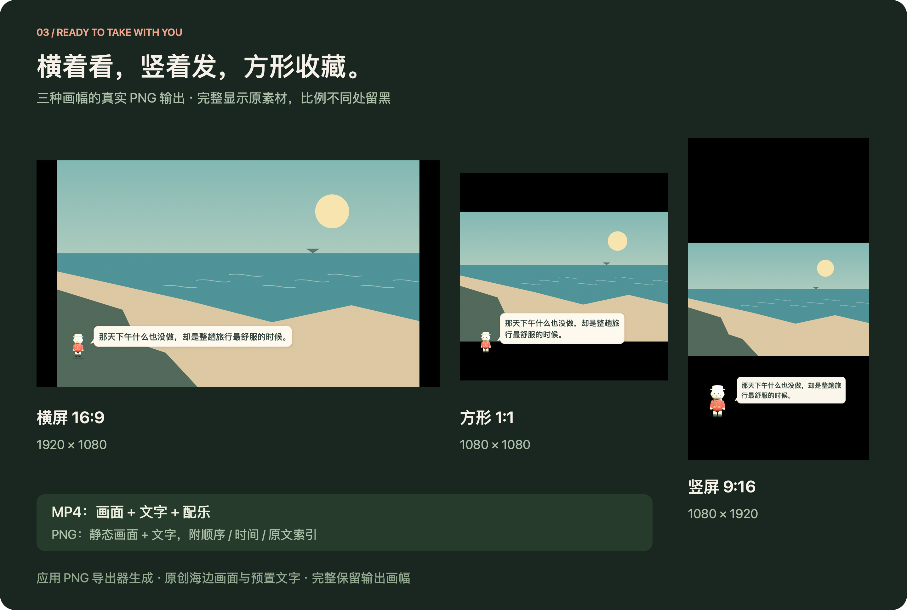
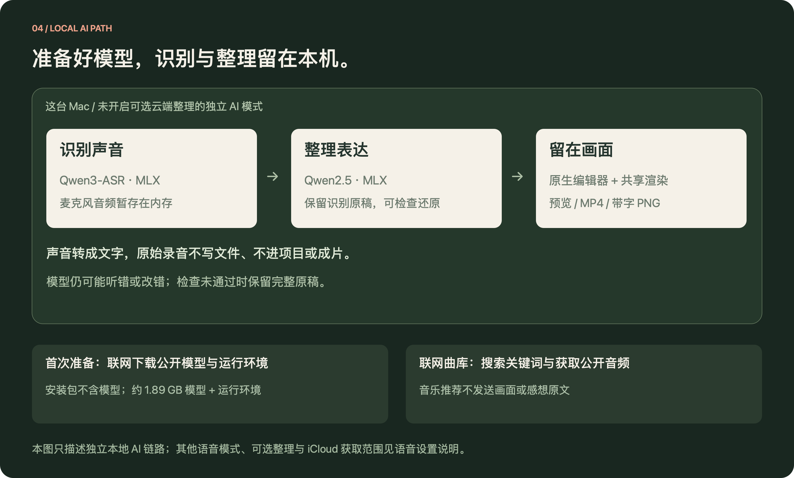

<p align="center">
  
</p>

<p align="center">
  <strong>映述 YingShu · 原生 Mac 旅行口述剪辑工具</strong><br>
  <code>v0.12.1</code> · <code>Apple Silicon</code> · <code>macOS 14+</code>
</p>

<p align="center">
  <a href="https://github.com/bill-gx114/yingshu/releases/tag/v0.12.1">下载 Mac 版</a> ·
  <a href="docs/使用说明.md">使用指南</a> ·
  <a href="docs/项目介绍.md">产品与实现</a>
</p>

照片记住了风景，你还记得当时的心情。

映述把“边看边说”变成剪辑方式。导入照片、视频和实况照片，看到想留住的画面时按 `R`：画面与配乐停下，等你说完。再按 `R`，口述转成文字，留在刚才的片段上，随后从原位置续播。

最后带走一部有画面、文字与配乐的 MP4，或一组可以继续编辑的带字 PNG。口述用于生成文字，当前成片不包含口述录音和原视频声音。

> 当前为持续迭代中的原生应用原型。发布包面向 Apple Silicon，尚未经过 Apple 公证。素材编辑、写字和导出可直接使用；独立本地 AI 另行准备，无需 API Key。

0.12 完善了作品保存与找回：⌘S 保存到原项目，⇧⌘S 另存；恢复副本显示真实写入状态。素材搬动后可重新关联，保留文字和剪辑；重新打开的时间轴保持保存时的安排。导出前检查缺失文件，写入前保护原素材。详细变更和验证边界见[本轮产品优化](docs/2026-10-20-产品优化.md)。

## 一次暂停，一句自己的话



1. **导入素材。** 从系统相册或本地文件选择照片、视频、Live Photo，默认按拍摄时间排列。
2. **边看边说。** 按 `R` 暂停画面与配乐，再按 `R` 结束口述；处理完成后落字并续播。
3. **检查表达。** 点击画面上的文字纠错，切换样式、调整显示时间、查看识别原稿；编辑支持撤销。
4. **导出作品。** 选择画幅和配乐，生成 MP4，或导出有序的带字 PNG。

准备独立模型后，可使用本机 Qwen 识别与整理。这一模式每句最长 120 秒，结束后整句处理，录制时不逐字显示转写。系统本机识别是另一条可选路径，具体表现见[本地 AI 与语音设置](docs/本地AI说明.md)。

## 同一句感想，四种留法



| 样式 | 适合怎样表达 |
| --- | --- |
| 字幕 | 沿画面阅读，一句清楚的补充。 |
| 贴纸 | 把一个短感受，贴在那一刻。 |
| 手记 | 给稍长的回忆，留一块安静的地方。 |
| 小人气泡 | 让原创黏土旅行者陪你讲述；无声，做一次轻柔侧转。 |

上图由应用的真实 PNG 导出器生成，使用原创示例画面和预置文字。多种样式可以同时出现并自动避让；预览、MP4 和 PNG 共用文字外观规则。小人的动作保留在 MP4 中，PNG 保存静态人物与气泡。

## 两种出口，三种画幅



| 成品 | 保存什么 | 接下来怎么用 |
| --- | --- | --- |
| MP4 短片 | 画面、文字、所选配乐，30 fps / SDR。 | 直接播放或分享。 |
| 带字 PNG | 按可见文字组合导出图片；视频和实况提取对应帧。附顺序、时间和原文索引。 | 做图文相册，或带到其他编辑工具继续制作。 |

素材按比例完整展示，画幅不同的部分会留黑。PNG 本身不播放动态，也不附带配乐。上图就是导出结果，未额外裁切或重排文字。

## 自动安排节奏，也留得下手动决定

| 你在意的事 | 当前能做什么 |
| --- | --- |
| 素材太多，先理顺 | 拍摄时间、智能叙事、文件名、导入顺序、手动五种顺序；文字跟随所属片段。 |
| 每张该停多久 | 本机 Vision、实际音乐节拍和文字阅读时间辅助编排；手动设置的片段优先。 |
| 动态照片别丢了 | 完整 Live Photo 作为一段动态素材，保留预览与视频导出的动态。 |
| 想改错字或撤回 | 点击画面文字直接修改，保留识别原稿；移除素材、文字编辑与重新关联支持撤销。 |
| 文件搬家后继续做 | 在缺失素材提示中选择原文件新位置；实况核验照片与 MOV 配对，保留感想、选段和时长。 |
| 想找到合适的音乐 | 按场景生成风格关键词，检索 CC0 / CC BY 曲目；最长 20 秒渐进试听，下载后可离线使用。 |

自动编排调整停留时长和视频选段，视频仍按正常速度播放。当前还没有变速曲线、复杂转场、旁白保留或项目素材迁移包。画面分析也无法替你判断一张照片的私人意义。

## 在 Mac 上开始

从 [v0.12.1 Release](https://github.com/bill-gx114/yingshu/releases/tag/v0.12.1) 下载 `YingShu-Mac.zip` 并解压。打开“映述.app”，点击“先试一下”，即可体验内置原创示例、修改文字和导出；也可以直接导入自己的照片和视频。更新时先正常退出旧版，再替换应用。

| 你想先做什么 | 需要准备什么 |
| --- | --- |
| 导入、预览、手写感想、保存项目、导出 MP4 / PNG | 打开应用即可，不需要独立 AI 模型。 |
| 用“系统本机”把口述转成文字 | 授权麦克风和语音识别；取决于 macOS 的中文识别资源是否可用。 |
| 用“AI 识别与整理”在本机完成整句识别与整理 | 按下面的双击流程准备两个模型和运行环境。无需 API Key。 |

**准备独立本地 AI：**

1. 在解压后的文件夹中，先看“首次使用说明.txt”，再双击“准备本地AI.command”。保留同文件夹内的配套文件。
2. 准备窗口会说明下载内容和联网来源，并逐阶段显示进度。两个模型合计约 **1.89 GB**，还需运行环境空间；首次准备需要联网和等待。无需安装 Git、Python 或开发工具，也无需管理员权限。
3. 等待窗口显示 **“本地 AI 准备完成”**，再正常退出并重新打开映述。到口述提示条右侧的“…” →“语音与整理设置”，选择“AI 识别与整理”。已有项目保留先前选择的模式，需要在这里主动切换。
4. 首次使用按提示授权麦克风，按 `R` 开始，说一句短感想，再按 `R` 结束。看到识别与整理后文字出现在原片段，才完成这台 Mac 的实际口述检查。模型首次加载可能需要等待。

准备失败或中断时，查看窗口给出的失败阶段和日志，再双击同一个准备器重试；已缓存的资源可复用。期间仍可使用素材编辑、导出和可用的系统本机识别。完整步骤、成功标准与排查方法见[本地 AI 与语音设置](docs/本地AI说明.md)。DeepSeek 是额外的云端文字整理选项，不是使用映述或准备本地 AI 的必需条件。

应用要求 **Apple Silicon（M 系列）与 macOS 14 或更高版本**。独立 AI 目前只在一台 macOS 27 / M5 Mac 上完成真实模型验收；其他机型与系统版本尚待验证，不能由应用的最低系统要求推定独立 AI 已在每台 Mac 上通过验证。发布包采用本地 ad-hoc 签名，可能受到 macOS 安全检查。

常用快捷键：`R` 开始 / 结束口述 · `空格` 播放 / 暂停 · `⌘I` 导入 · `⌘T` 写一句 · `⌘S` 保存 · `⌘Z` 撤销。

从文件导入的素材由项目引用，请保留原文件位置；从相册选择器导入的资源会保存在应用自己的本机数据目录。

<details>
<summary>处理位置、联网范围与开发入口</summary>

### 模型准备后，本机完成识别与整理



Qwen3-ASR 识别声音，Qwen2.5 整理文字。在未开启可选云端整理的独立 AI 模式下，模型准备完成后可离线识别与整理；音频仅暂存在内存，不写录音文件。模型可能听错或改错，保守检查不通过时保留完整原稿。

联网曲库会发送搜索关键词；相册中尚未下载的 iCloud 素材可能需要联网获取。Apple 系统服务须明确选择，允许 Apple 联网处理音频。设置中还保留独立的可选云端文字整理入口，其启用条件、费用和发送范围集中见[语音设置说明](docs/本地AI说明.md#可选云端文字整理)。本机识别失败不会自动切到联网语音模式。

### 从源码构建

```sh
bash scripts/build-app.sh
```

产物为 `dist/映述.app`。应用使用 SwiftUI、AppKit、AVFoundation、Vision 与 Speech，Swift 应用层没有第三方包依赖；独立 AI 由本机 Python / MLX 进程执行。应用运行不依赖 ffmpeg。验证脚本、依赖和覆盖边界见[开发与验证](docs/开发与验证.md)。

</details>

## 继续了解

| 文档 | 内容 |
| --- | --- |
| [使用说明](docs/使用说明.md) | 操作、快捷键、权限和项目保存。 |
| [产品与实现](docs/项目介绍.md) | 产品动机、交互、架构取舍与后续方向。 |
| [本地 AI 与语音设置](docs/本地AI说明.md) | 模型准备、识别模式和数据处理范围。 |
| [素材格式支持](docs/素材格式支持.md) | 图片、视频、Live Photo 的兼容边界。 |
| [配乐曲库](docs/配乐曲库说明.md) | 搜索、试听、下载和署名。 |
| [小人气泡](docs/小人气泡说明.md) / [图片导出](docs/字幕图片导出.md) | 文字呈现与分享。 |
| [交互展示源码](docs/showcase/index.html) | 下载仓库后本地打开 HTML，点击或按 R 演示流程。GitHub 文件页显示源码。 |

展示图的来源和生成方式见[素材说明](docs/showcase/provenance.md)。示例插画与黏土角色为项目原创；随附音乐见[授权说明](Resources/音乐与示例授权.md)。公开模型、运行时和曲目各适用来源许可，本仓库没有另行授予统一的开源许可。
