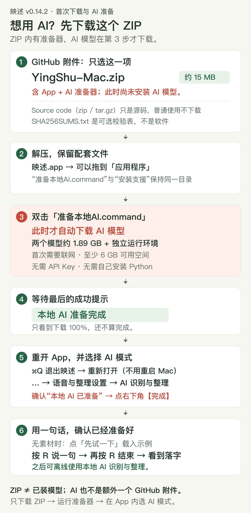

# 从下载到用上 AI：第一次使用映述

**下载 `YingShu-Mac.zip` 就选对了。** 它里面有应用和 AI 准备器；随后双击准备器，才会下载 AI 模型。这里没有另一个需要你选择的“AI 版”安装包。

### [⬇ 下载 Mac 应用＋AI 准备器（YingShu-Mac.zip，约 15 MB）](https://github.com/bill-gx114/yingshu/releases/download/v0.14.2/YingShu-Mac.zip)

[返回 GitHub 下载页](https://github.com/bill-gx114/yingshu/releases/tag/v0.14.2) · [返回项目首页](../README.md)

开始前：需要 **M 系列 Mac（Apple Silicon）与 macOS 14 或更新版本**。首次准备 AI 要联网，并留出至少 **6 GB** 空间。两个模型合计约 **1.89 GB**，还需运行环境、缓存与解压空间。



## 先认清下载页上的四个附件

| 你看到的名字 | 用途 | 该怎么选 |
| --- | --- | --- |
| **YingShu-Mac.zip** | **映述 App、AI 自动准备器、中文说明** | **下载这一项即可。** |
| SHA256SUMS.txt | 可选的文件校验表 | 用于核对下载是否完整，不是 App 或模型。 |
| Source code (zip)／源代码 (zip) | 开发者用的源码 | 普通使用不需要下载。 |
| Source code (tar.gz)／源代码 (tar.gz) | 同一源码的另一种压缩格式 | 普通使用不需要下载。 |

GitHub 自动提供的“源代码”附件不能直接当 App 打开。ZIP 只有约 15 MB，是因为 **约 1.89 GB 的 AI 模型会在第 3 步另行下载**。

## 第 1 步：下载并解压

点击本页上面的“下载 Mac 应用＋AI 准备器”。下载后，在 Finder 的“下载”文件夹双击 `YingShu-Mac.zip`。

解压后应看到以下四项：

```text
映述.app                  ← 应用本体
准备本地AI.command         ← 双击后，自动安装 AI 运行环境和模型
首次使用说明.txt            ← 可以直接打开阅读
安装支援/                 ← 准备器要用的文件夹，保留在旁边
```

**现在的状态：** 你拿到了应用和准备器，AI 模型还没装好。只解压或打开 App，不会自动开始下载模型。

## 第 2 步：把应用放进“应用程序”

把 **“映述.app”拖入 Finder 左侧的“应用程序”**，以后从“应用程序”里打开它。

打开后点击 **“先试一下”**，可体验内置原创示例，修改文字或导出 MP4／PNG。也可以导入自己的照片和视频。这些功能无需等待独立 AI 准备。

**现在的状态：** 编辑和导出可以先用；如果要让本地 AI 识别、整理口述，请继续第 3 步。

### 如果 App 被 Mac 阻止打开

本版尚未经过 Apple 公证。确认下载来自本项目、文件未被替换后，按 [Apple 官方说明](https://support.apple.com/zh-cn/102445)处理：尝试打开 App 后，进入“系统设置 → 隐私与安全性”，找到这次拦截提示，按系统提供的 **“仍要打开”** 和后续确认操作。不要关闭 Mac 的全局安全检查。

## 第 3 步：双击准备器，此时才开始下载 AI

回到第 1 步解压出来的文件夹，双击 **“准备本地AI.command”**。

它会打开 Mac 的 **“终端”**。这是准备器的进度窗口，会显示当前阶段、下载内容与日志位置。保持联网，让这个窗口继续运行。

它会自动完成这些事情：

1. 检查芯片、系统和可用空间。
2. 安装应用独立使用的 Python 与 AI 运行环境，不修改系统 Python。
3. 下载两个固定版本模型：语音识别约 1.01 GB，文字整理约 0.88 GB，合计约 **1.89 GB**。
4. 检查文件，并实际加载两个模型，确认能运行。

你不需要自行安装 Python、Git、Homebrew 或开发工具，也不需要输入 API Key、管理员密码，或到模型网站手动挑选文件。

**注意：** 只把 App 移到“应用程序”就好。“准备本地AI.command”与“安装支援”文件夹要保持在同一个解压目录，不要只移动其中一份。下载时间受网络影响，不承诺固定几分钟。

### 如果准备器不能双击打开

1. 打开 Mac 自带的“终端”（可按 ⌘空格，搜索“终端”）。
2. 输入 `/bin/bash`，再输入**一个空格**，先不要按回车。
3. 把解压目录里的 **“准备本地AI.command”拖进终端窗口**，让 Mac 自动填入它的完整路径。
4. 按回车，等待准备器运行。不需要 sudo 或管理员密码。

## 第 4 步：认准成功提示

只有在终端看到下面这句话，才表示 AI 已准备成功：

> **本地 AI 准备完成**

只看到某个文件“100%”或“下载完成”，并不表示全部准备结束；后面还要核验文件并加载模型。

如果出现失败或你中途关闭了窗口，处理窗口最后显示的原因后，再双击**同一个准备器**。已完成的下载会保留并复用，无需先删除所有模型。

**现在的状态：** 这台 Mac 已具备本地 AI 运行资源，还要在映述里选中相应模式。

## 第 5 步：重新打开映述，选好模式并点“完成”

1. 切回映述，按 **⌘Q 退出应用**，再从“应用程序”重新打开。**只需要重开映述，不需要重启 Mac。**
2. 进入内置示例或自己的作品，找到口述提示条右侧的 **“…”**。
3. 点击 **“语音与整理设置…”**，选中 **“AI 识别与整理”**。
4. 查看此时显示的“本机 AI 运行环境”，应看到 **“本地 AI 已准备”**。
5. 点击右下角 **“完成”**，回到编辑器。

已有作品会记住原来的识别模式，下载模型不会替作品自动切换。设置窗口还开着时无法录制，所以选好模式后一定要点“完成”。“准备增强中文模型”是 Apple 系统识别的另一条路径，不能代替第 3 步的独立 AI 准备器。

**现在的状态：** 本地 AI 已安装，并且当前作品已选中这一识别方式。

## 第 6 步：说一句，检查文字是否出现

1. 没有素材时先点 **“先试一下”** 载入内置示例，或导入自己的素材。
2. 在编辑器中点击 **“开始口述”** 或按 **R**，按系统提示允许麦克风权限。
3. 说一句短感想，例如：“今天的海边很安静。”
4. 再点 **“录制中 · 点击结束”** 或按 **R**，等待识别、整理；首次加载可能需要稍等。
5. 看到文字留在刚才的画面上，便完成这台 Mac 的实际口述检查。

正常口述会先暂停画面与配乐，处理后落字，再从原位置续播。独立模型录制期间不逐字显示转写，会在说完后处理整句。

准备成功后，本地 AI 可离线识别与整理，不用每次打开应用都运行准备器。联网曲库、iCloud 素材和主动选择的云端服务仍各自需要网络。

## 常见疑问

| 疑问 | 答案 |
| --- | --- |
| 只有 15 MB，是不是没下载到 AI 版？ | 选对了。它包含应用和准备器；双击准备器时，才下载约 1.89 GB 的 AI 模型，并另行安装独立运行环境。 |
| 还需要在 GitHub 下载另一个 AI 附件吗？ | 不需要。本地 AI 由“准备本地AI.command”自动下载。 |
| 看到 DeepSeek API Key 输入框，必须填吗？ | 不需要。DeepSeek 是可选云端整理，本地 AI 不需要 API Key。 |
| 准备器下载很慢或失败了怎么办？ | 查看窗口末尾的阶段和错误，恢复网络或腾出空间后重跑同一个准备器；已有下载可复用。 |
| 已显示完成，App 还说未准备？ | ⌘Q 退出映述再打开，按第 5 步查看状态、切换模式并点“完成”。仍失败时保留日志。 |
| 是不是每次更新 App 都要重新下载模型？ | 不需要。先退出旧版并替换 App；模型保存在这台 Mac 的应用数据目录。换另一台 Mac 则需在那台 Mac 上准备。 |

准备日志在 `~/Library/Application Support/YingShu/AI Runtime/setup-logs/`。在 Finder“前往 → 前往文件夹…”中粘贴这段路径即可找到。日志可能含本机用户名和路径，分享前请检查。

独立 AI 的真实测试目前限单台 Mac；不同设备、口音和环境下的速度与准确率可能不同。更详细的模型来源、数据处理范围和性能边界见[本地 AI 与语音设置](本地AI说明.md)。
