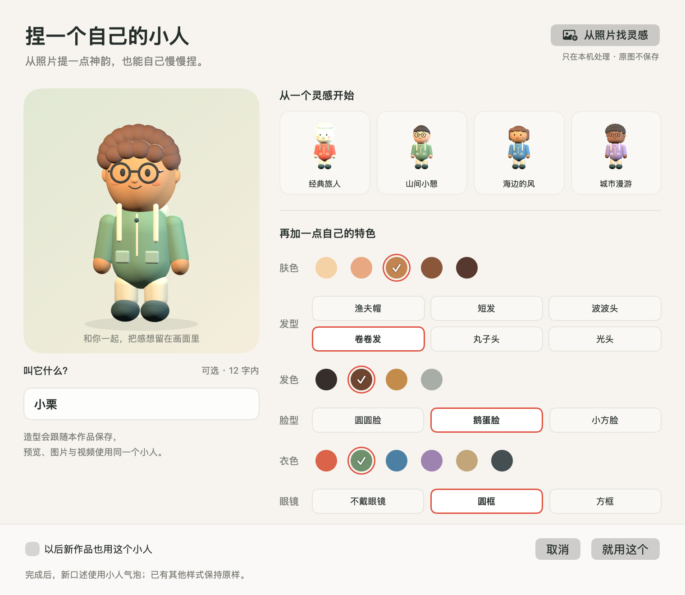

# 小人气泡与我的小人

用一个专属黏土小人和文字气泡，表达你对画面的感想。人物无声，不生成朗读或嘴型，口述录音不进入成片。

## 三步捏一个自己的小人

1. 点击编辑器右侧顶部 **“我的小人”**。
2. 先选一个灵感造型，或点 **“从照片找灵感”** 选择一张清楚的单人正面照。生成草稿后，再点选肤色、发型、发色、脸型、衣色和眼镜；左侧随时预览。也可以取一个十二字内的昵称，昵称只在编辑器中显示。
3. 点击 **“就用这个”**。新口述自动使用小人气泡。勾选“以后新作品也用这个小人”，之后新建的作品也会使用它。

四个灵感分别为经典旅人、山间小憩、海边的风和城市漫游。无需从零搭配；想修改时再打开同一页面即可。渔夫帽和光头没有露出的头发，所以暂不提供发色修改。所有人物在本机生成，**不用另下模型、把照片传到服务器或填写 API Key**。

## 用照片保留一点神韵

照片只作为灵感：参考配色、粗略脸型与少量五官特点，转换成离散的黏土风选项，保留圆润大头比例，不生成精确人脸或专属三维模型。默认渔夫帽会换成短发，方便看到参考发色；它不代表识别出了照片发型。你已选择的其他发型、眼镜与昵称保留，仍可继续点选。

优先选光线均匀、脸部清楚、接近正面的单人照，保留头顶和肩膀。支持 JPEG、PNG、HEIC / HEIF，最多 40 MB、一亿像素；照片会先缩小再分析。多人照片请先裁出想参考的人，明显侧脸或脸太小时会提示换图；失败不会清空现有草稿。

分析时可以点“停止”返回手动编辑，也可以取消整个编辑器。点“回到默认五官”只清除参考的眼形、眼距和微笑，保留配色与服装。光线、背景和遮挡会影响参考效果，发型和眼镜需要自行选择；这不是相似度保证。

照片在本机临时读取，映述不将原图、文件路径与原始五官点写入项目、恢复文件、个人默认或人物缓存。只在点“就用这个”后保存离散的造型选项。选图和分析本身不会改变已保存的作品。

取消不改变作品。确认的造型随项目保存、恢复，并支持撤销重做；打开旧作品仍使用原来的经典小人，不会被个人默认替换。已有的小人气泡统一采用当前作品的形象，其他样式不会自动改变。

## 把小人放进画面

- 新感想：在口述按钮右侧选择“小人气泡 · 无声”，按 R 口述；也可点“写一句”输入文字。
- 已有感想：在右侧点开感想，切换为“小人气泡”。文字、所属片段和显示时间保留。
- 点击画面上的小人或气泡可编辑文字；暂停、播放和拖动时，角色姿态由画面时间确定。
- MP4 中气泡轻轻弹出，小人做一次约 1.2 秒的侧转，再停在正面。PNG 保留静态人物与气泡。

人物与气泡共同参与四种文字样式的避让。长文字会按画布缩小，建议每次表达一个小感受。

## 数据与实现

形象配置保存在项目中，个人默认保存在本机应用偏好中，不新增照片或人物模型文件。经典角色继续使用 Resources 中的 25 张 PNG；自定义角色由 CompanionStickerRenderer.swift 通过 SceneKit 在本机生成透明姿态，只做有限的内存缓存。

预览、图片与视频共享气泡排版和人物姿态。动作按感想原来的开始时间计时，文字重叠导致分组拆层时不会重新转身。当前不支持将照片直接作为角色贴图或导入外部 3D 模型。

原创角色来源见内置《小人素材说明》，使用与验证边界见[开发与验证](https://github.com/bill-gx114/yingshu/blob/main/docs/开发与验证.md)。
