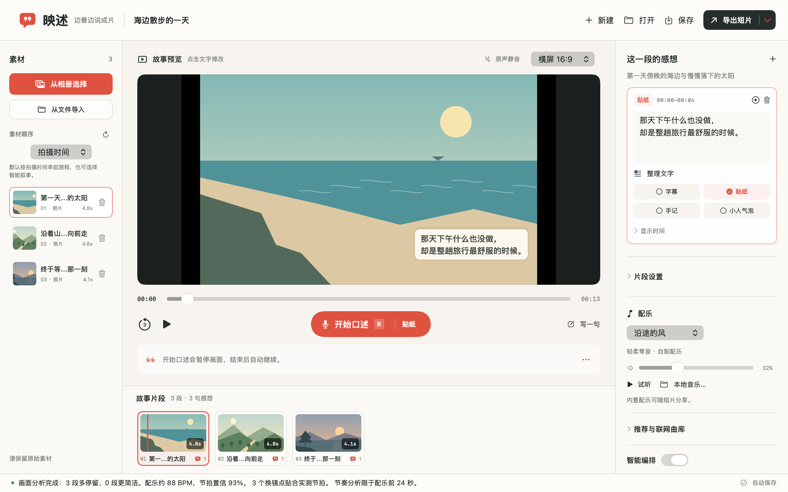

# 映述 · 看见那一刻，说出你的故事

**映述（YingShu）是一款原生 Mac 旅行口述剪辑工具。** 它把照片和视频整理成可观看的时间轴，让人先看见回忆，再用自己的话补上回忆里的感受。

当前版本为 **0.14.2**。核心流程已经实现：导入素材、安排顺序与停留时间、暂停口述、识别整理、检查文字，以及 MP4 / PNG 导出。0.14 增加完全本机的照片参考入口，提炼有限配色和离散五官，再微调为可爱黏土形象；不保存原照片。0.13 增加“我的小人”：用少量点选捏出专属黏土旅伴，随作品保存，并贯穿预览、PNG 与 MP4。0.12 已补齐真实保存状态、原路径保存、素材重新关联与时间轴恢复一致性。项目仍处于原生应用原型阶段，正在完善真实素材与不同设备的使用验证。

## 从一张照片，到一句自己的话

旅行回来，素材往往很多。山、海、街道、同行的人都在相册里，但“为什么记得这一刻”没有一起被保存。

映述从一个具体动作切入：**看见想说的画面，就停下来讲一句。** 使用者不必先写完文案，再把每一句拖到时间轴上；画面成为提示，口述成为表达，文字自动留在表达发生的地方。

它适合整理一次旅行、一次散步、与家人的一段相聚，或把一组零散照片变成有自己声音的图文叙事。这里的“声音”体现在文字里：当前成片不包含口述录音和原视频声音，而是由画面、文字和独立配乐组成。

## 把复杂度藏在一次暂停后面

三栏工作台围绕同一个画面组织：左侧是素材与顺序，中间是预览和时间轴，右侧是感想与文字编辑。

最重要的交互只有两个按键动作：

- **第一次按 R：** 画面与配乐立即暂停，开始接收这一句口述。
- **第二次按 R：** 结束收音，显示识别与整理进度；文字落到停住的片段，随后从原位置续播。

冻结画面让使用者按照自己的节奏说话，也让文字的归属清晰。独立本地 AI 模式每句最长 120 秒，录制中不逐字显示转写，结束后整句处理；系统识别模式可以显示实时文字。准备与处理可以取消，取消不会把迟到结果插入下一次口述。

应用保留了修改的余地：点击画面上的文字直接纠错，查看或还原识别原稿，调整显示时间，撤销一次落字。对已有文字再次请求 AI 整理时，先查看建议，再采用并完成，手改内容不会被后台结果直接替换。

## 让文字成为画面的一部分

映述提供四种感想呈现：

| 形式 | 表达方式 |
| --- | --- |
| 字幕 | 沿画面阅读，一句清楚的补充。 |
| 贴纸 | 把短感受放进画面，像旅途中贴下的标记。 |
| 手记 | 容纳稍长的回忆，让文字有自己的停留空间。 |
| 小人气泡 | 一位小比例原创黏土旅行者与文字气泡，做一次轻柔侧转；无声，也不对口型。 |

同一片段可以同时显示多种样式，渲染时自动避让。预览、MP4 和 PNG 共用外观规则；MP4 保留小人的动作，PNG 留下静态人物与气泡。当前提供一款默认角色。

## 自动编排，保留人的决定

映述的自动化处理可描述、可检查的部分。

**顺序有明确依据。** 新素材默认按拍摄时间排列，时间缺失时说明回退依据。使用者也可以选择文件名、导入顺序、手动顺序，或显式启用本机 Vision 辅助的“智能叙事”：在有限窗口内利用画面相似程度、人脸与时间分组，减少相邻重复，穿插照片与动态素材。导出不会再次打乱顺序。

**节奏来自实际音频。** 应用分析音乐的瞬态与周期，在节奏足够稳定时参考实测节拍安排换镜；节奏不明确时回到画面内容与阅读时间，不假设一个固定 BPM。照片通常停留约 1.5–7 秒，文字较多时可以延长；视频和 Live Photo 受原片长度限制。

**手动调整具有优先权。** 调整片段起点或时长后，该片段锁定，自动编排保留设置；需要时可恢复自动。自动分析保留全部素材，不替使用者删除照片。误导入的素材可移除并撤销，关联文字随素材恢复，原文件始终保留。

这些能力安排的是片段的选段和停留时长。当前视频保持正常速度，没有变速曲线。画面分析也不能判断一张普通照片对某个人的特殊意义，这部分需要使用者自己决定。

## 两种成品，同一段表达

三种画幅均按比例完整展示素材，比例不同处留黑；图中保留真实输出，没有额外裁切。

**MP4** 把画面、文字和独立配乐合成一部短片，适合直接观看。导出前检查文字阅读时间与当前配乐对应的编排；需要调整时先更新可见时间轴，再选择保存位置。

**带字 PNG** 按可见文字组合导出有序图片，视频与 Live Photo 提取对应帧，并保留顺序、时间与文字索引。图片不附带应用配乐，适合继续在其他编辑工具里制作。

联网配乐来自公开曲库，只接收 CC0 / CC BY 许可明确的结果。可以先渐进试听最长 20 秒，再选择是否下载。下载前复核元数据和许可，下载后检查实际音频；所选音乐不会被推荐或试听替换。需要署名的曲目在 MP4 旁附带署名文本，来源许可也保留在项目里。

## 本地优先的处理架构

| 层 | 当前实现 | 选择的理由 |
| --- | --- | --- |
| 编辑器 | SwiftUI 三栏界面，项目状态、播放与撤销集中管理。 | 让导入、口述、文字与导出围绕同一个项目工作。 |
| 媒体 | ImageIO / AVFoundation 解码、预览与合成；PhotosPicker 读取选中资源。 | 使用系统媒体能力，Live Photo 保存完整照片与动态资源。 |
| 编排 | Apple Vision 画面特征、音频节拍、文字阅读约束。 | 把自动结果建立在可验证的信号上，保留人工控制。 |
| 独立 AI | 原生端内存收音；本机 Python / MLX 进程运行 Qwen3-ASR 与 Qwen2.5。 | 无需第三方 API Key，模型准备后可离线识别与整理。 |
| 联网曲库 | 按音乐关键词提供公开曲目搜索与音频。 | 不上传画面或感想原文，试听与采用分别操作。 |
| 输出 | MP4 原子导出、PNG 分批生成后发布。 | 失败或取消时尽量保留已有项目与原输出。 |

字幕保存在所属片段内，并用稳定 ID 关联。移动片段时文字跟随；重新编排时保留文字内容与 ID，再计算显示区间。异步任务采用输入快照、取消与代次隔离，旧任务完成后不会覆盖新项目。

独立 AI 运行时使用固定清单和有界进程协议，项目与模型输出不能指定执行命令。准备脚本显式下载公开依赖与固定版本模型，并记录许可、revision 和文件哈希；推理 worker 自身不下载模型，不执行远程模型代码。

## 数据边界与真实限制

安装包不含独立模型。模型就绪时推荐本地 AI；未准备时使用系统本机识别，可用性取决于 macOS 和中文资源。

模型准备完成后，在未开启可选云端整理的独立 AI 链路中，音频暂存在内存，识别与文字整理都在本机执行。原始识别稿和整理结果随项目本地保存，音频不写成录音文件、不进入成片。第一次模型准备需要联网下载，模型与独立 Python 环境不随应用包分发；两组模型合计约 1.89 GB，另有运行环境。

设置里保留的可选云端文字整理，其启用、费用和发送范围见[语音设置说明](本地AI说明.md#可选云端文字整理)。显式选择 Apple 系统服务时，音频可能由 Apple 联网处理；本机识别不可用不会自动开启它。曲库请求包含关键词、公开曲目信息与音频地址，照片、视频和感想原文不上传。

语音模型可能听错，文字模型也可能改错。应用保守检查数字、保护词、否定、不确定语气和内容保留，检查失败时保留完整原稿；这些检查不能证明语义必然正确。当前没有可推广到真实口音、噪声和所有设备的准确率结论，也不以其他产品的效果作为承诺。

原生界面的部署目标为 macOS 14+，当前发布二进制为 arm64。本地 AI 已有单台 Apple Silicon Mac 的真实模型验证，其他机型和旧系统尚待验收。应用采用本地 ad-hoc 签名，尚未经过 Apple 公证。HDR 输出、真实 iPhone ProRAW / Dolby Vision、Live Photo 与 iCloud 的具体兼容边界见[素材格式支持](素材格式支持.md)。

## 下一步，先验证真实使用

已实现的功能需要进一步放到真实旅行素材里检验。下一阶段优先观察三个问题：一组素材从导入到导出需要多久，口述文字需要改多少次，使用者是否愿意采用自动安排的时长。

以下是后续方向，尚未作为当前能力交付：

- 让使用者表达“这一张对我很重要”，主动提高某个画面的停留权重。
- 更多文字排版与人脸避让，字幕文件导出。
- 项目素材打包与迁移，让项目更容易换一台 Mac 继续编辑。
- 可选保留旁白 / 环境声、照片轻运动、变速曲线与转场。
- 经授权的商业曲库，以及更丰富的角色与视觉样式。

映述希望把一次表达所需的操作缩短：先看见，再说出，最后留下。

---

[返回首页](../README.md) · [使用指南](使用说明.md) · [本地 AI 说明](本地AI说明.md) · [开发与验证](开发与验证.md) · [交互展示源码](showcase/index.html)
